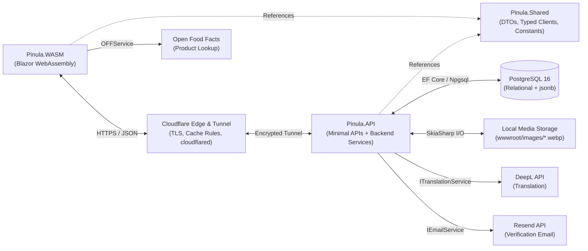

# Pinula 

Pinula is a full-stack recipe management, nutritional tracking, meal planning, and pantry inventory system built with ASP.NET Core Minimal APIs, Blazor WebAssembly, and PostgreSQL.

---

## System Overview

Pinula is a multi-user platform for collaborative household meal planning, pantry tracking, and recipe management. Users share global recipes and nutritional data while managing private household groups (`Group`) with synchronized pantries, meal calendars, and shopping lists.

* **Full-Stack .NET 10 Architecture:** Pairs a stateless ASP.NET Core Minimal API backend (`Pinula.API`) with a Blazor WebAssembly SPA (`Pinula.WASM`), sharing DTOs, validation contracts (`GeneralResponse`), and typed HTTP clients via `Pinula.Shared`.
* **Multi-Language & Nutritional Domain:** Stores localized content in PostgreSQL `jsonb` columns (`en`/`cs` with deterministic fallback) and normalizes ingredient units into grams to calculate per-recipe calories and macronutrients.
* **FEFO Pantry & Shopping Automation:** Allocates household stock to planned meals by earliest expiration date (`FEFO`) and automatically generates shopping list entries for missing ingredients.
* **Self-Hosted Container Stack:** Runs in Docker Compose on Proxmox LXC containers behind Cloudflare Tunnel ingress, with `SkiaSharp` WebP media processing and GitHub Actions CI.

---

## High-Level Architecture



---

## Solution Structure

The solution (`CookRecipesApp.slnx`) partitions responsibilities across server execution, shared contracts, client UI, automated tests, and offline data tooling:

| Path | Role | Responsibility |
| --- | --- | --- |
| `Pinula.API/` | ASP.NET Core Web API | Exposes thin Minimal API endpoints (`Endpoints/`), executes stateless business logic (`Services/`), manages EF Core persistence (`Context/PinulaDbContext.cs`), and processes WebP media via `SkiaSharp`. |
| `Pinula.Shared/` | .NET Class Library | Defines shared DTOs (`DTOs/`), unified response contracts (`GeneralResponse`), domain enums (`Enums/`), asset constants (`Constants/ImageConstants.cs`), and typed HTTP clients (`Services/*ApiClient.cs`). |
| `Pinula.WASM/` | Blazor WebAssembly | Renders the client SPA (`Pages/`, `Components/`), manages JWT auth state (`ApiAuthenticationStateProvider`), and communicates with the API exclusively through `Pinula.Shared` client interfaces. |
| `Pinula.API.Tests/` | xUnit Test Project | Verifies backend services in isolation (`Services/CategoryBackendServiceTests.cs`) against relational SQLite in-memory databases (`TestHelpers/TestDbContextFactory.cs`). |
| `tools/data-generator/` | Python CLI Tooling | Executes offline nutritional and translation enrichment (`enrich_ingredients.py`, `schemas.py`) and image generation (`generate_images_ingredients.py`) against administrative API endpoints. |

---

## Architecture & Documentation Index

* **[`docs/ARCHITECTURE.md`](docs/ARCHITECTURE.md)** — Covers the 3-tier request pipeline, thin Minimal APIs (`*Endpoint.cs`) and stateless backend services (`*BackendService.cs`), unified `GeneralResponse` contracts, SQL expression projections vs. Mapster adaptation, the FEFO pantry allocation engine, cross-cutting concerns, and SQLite in-memory testing.
* **[`docs/DATABASE_AND_STORAGE.md`](docs/DATABASE_AND_STORAGE.md)** — Details the relational entity model, PostgreSQL `jsonb` localization and fallback resolution, base-gram unit normalization, the `SkiaSharp` WebP media pipeline (`IImageProcessingService`), and data seeding/enrichment tooling.
* **[`docs/DEPLOYMENT.md`](docs/DEPLOYMENT.md)** — Documents the Proxmox LXC topology, local development against the staging database, Docker Compose service definitions, the SSH pull-based `deploy.sh` workflow, Cloudflare tunnel and GitHub Actions CI.
* **[`docs/ADR.md`](docs/ADR.md)** — Records core Architecture Decision Records (`ADR-001` through `ADR-009`), including technical context, chosen solutions, and engineering trade-offs.
* **[`LICENSE`](LICENSE)** — MIT License.

---

## Tech Stack

* **Backend:** .NET 10, ASP.NET Core Minimal APIs, Entity Framework Core + Npgsql, Mapster, BCrypt.Net, JWT Bearer Authentication
* **Frontend:** Blazor WebAssembly, Bootstrap 5, `.resx` Localization, Nginx
* **Database:** PostgreSQL 16 (`jsonb` column mapping), SQLite In-Memory (relational test provider)
* **Media & External Integrations:** SkiaSharp (`SkiaSharp.NativeAssets.Linux.NoDependencies`), DeepL (`ITranslationService`), Resend (`IEmailService`), Open Food Facts (`OFFService`)
* **Testing & Infrastructure:** xUnit, FluentAssertions, Moq, Docker & Docker Compose, Proxmox LXC, Cloudflare Tunnel & Edge Caching, GitHub Actions (`.github/workflows/test.yml`)

---

## Local Development & Testing

### Prerequisites

* .NET 10 SDK (pinned in `global.json`)
* Access to a PostgreSQL 16 instance (the shared staging database or a local container)

### Setup & Execution

1. **Configure API settings:**
   Copy `Pinula.API/appsettings.example.json` and `Pinula.API/appsettings.example.Development.json` to `appsettings.json` and `appsettings.Development.json`, then populate `ConnectionStrings:DefaultConnection`, `JWTKey:Default`, and external service keys (`Resend`, `DeepL`).
2. **Verify client API routing (`Pinula.WASM/Program.cs`):**
   `Pinula.WASM` does not read the backend URL from `appsettings*.json`. Instead, `Pinula.WASM/Program.cs` resolves the target API host dynamically from `builder.HostEnvironment.BaseAddress` (`stage.pinula.app` -> `[https://stage-api.pinula.app](https://stage-api.pinula.app)`, `pinula.app` -> `[https://api.pinula.app](https://api.pinula.app)`, and `[http://10.0.20.2:5017/](http://10.0.20.2:5017/)` for local development). Update the fallback URL in `Pinula.WASM/Program.cs` if your local API runs on a different host or port.
3. **Build the solution:**
   ```bash
   dotnet build CookRecipesApp.slnx --configuration Release
   ```
4. **Apply pending migrations and run the API and Blazor WASM client:**
   ```bash
   dotnet ef database update --project Pinula.API
   dotnet run --project Pinula.API
   dotnet run --project Pinula.WASM
   ```
5. **Run the automated test suite:**
   ```bash
   dotnet test CookRecipesApp.slnx --configuration Release
   ```

### Database Migrations

Schema migrations (`Pinula.API/Migrations/`) are not executed automatically during application startup (`Program.cs`). After deploying code changes, the operator must apply pending EF Core migrations manually against the target database before testing or routing traffic:

```bash
dotnet ef database update --project Pinula.API
```

* **Rationale:** Because local development connects directly to the shared `Pinula_Stage` database, disabling automatic startup migrations prevents work-in-progress `PinulaDbContext` or entity model changes from accidentally altering the staging schema before a migration is explicitly authored and reviewed.
