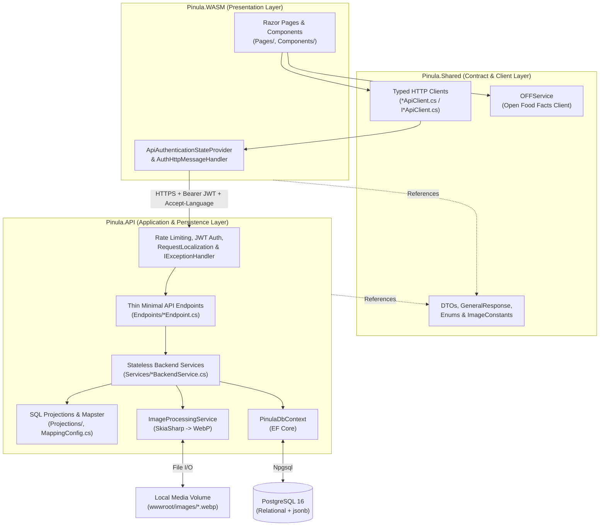
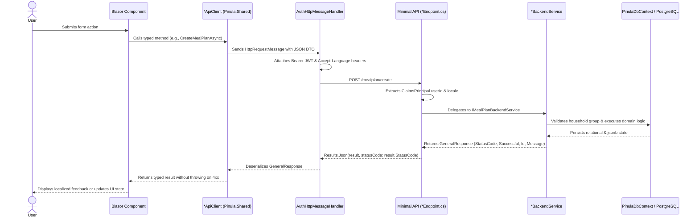

# System Architecture & Domain Design

Pinula is a full-stack recipe management, nutritional tracking, meal planning, and pantry inventory system built on a clean 3-tier architecture across ASP.NET Core Minimal APIs, Blazor WebAssembly, and PostgreSQL.

---

## 1. Solution Structure & Technology Stack

The solution (`CookRecipesApp.slnx`) enforces compile-time separation between client presentation, shared contracts, server execution, automated tests, and offline data tooling:

| Project / Directory | Framework & Key Libraries                                                                                   | Architectural Responsibility |
| :--- |:------------------------------------------------------------------------------------------------------------| :--- |
| **`Pinula.API`** | .NET 10, ASP.NET Core Minimal APIs, EF Core + Npgsql, Mapster, SkiaSharp, BCrypt.Net, JWT Bearer, DeepL.net | Exposes HTTP endpoints (`Endpoints/`), executes stateless business logic (`Services/`), manages PostgreSQL persistence (`Context/PinulaDbContext.cs`), and processes WebP media (`ImageProcessingService.cs`). |
| **`Pinula.Shared`** | .NET 10 Class Library, `System.Net.Http.Json`                                                               | Defines shared DTOs (`DTOs/`), unified response wrappers (`GeneralResponse`), domain enums (`Enums/`), asset constants (`ImageConstants.cs`), and typed HTTP clients (`Services/*ApiClient.cs`). |
| **`Pinula.WASM`** | Blazor WebAssembly, Bootstrap 5, `.resx` Localization                                                       | Renders the client SPA (`Pages/`, `Components/`), manages JWT auth state (`ApiAuthenticationStateProvider.cs`), and consumes backend endpoints exclusively through `Pinula.Shared` client interfaces. |
| **`Pinula.API.Tests`** | xUnit, FluentAssertions, Moq, `Microsoft.EntityFrameworkCore.Sqlite`                                        | Tests backend services in isolation (`Services/CategoryBackendServiceTests.cs`) against relational SQLite in-memory databases (`TestHelpers/TestDbContextFactory.cs`). |
| **`tools/data-generator`** | Python 3, Pydantic (`schemas.py`)                                                                           | Performs offline AI nutritional/translation enrichment (`enrich_ingredients.py`) and image generation (`generate_images_ingredients.py`), pushing updates through administrative API routes (`ScriptEndpoint.cs`). |

---

## 2. Architectural Layers & Boundaries

### Strict Dependency Rules

1. **Thin Endpoints (`Pinula.API/Endpoints/*Endpoint.cs`):**
    * Endpoints act solely as HTTP adapters. They hold **zero** references to `PinulaDbContext`.
    * Each route handler extracts the authenticated user ID (`ClaimsPrincipal.GetUserId()`), request origin (`baseUrl`), and active locale (`CultureInfo.CurrentCulture.TwoLetterISOLanguageName` populated from `Accept-Language`), parses multipart form payloads when uploading files, and delegates execution to an injected `I*BackendService`.
2. **Transport-Agnostic Services (`Pinula.API/Services/*BackendService.cs`):**
    * Backend services hold **zero** dependencies on `HttpRequest`, `HttpContext`, or `IWebHostEnvironment`.
    * Services accept primitive parameters (`Guid userId`, `string baseUrl`, `string lang`, `Stream` for media) and return DTOs or `GeneralResponse` objects, allowing direct invocation from xUnit tests and `NutriDbSeeder.cs`.
3. **UI Decoupling (`Pinula.WASM`):**
    * Razor components never construct raw API URLs or invoke `HttpClient` directly. All server communication routes through constructor-injected interfaces (`IRecipeApiClient`, `IIngredientApiClient`, `IInventoryApiClient`, `IMealPlanApiClient`, `ICategoryApiClient`, `IUnitApiClient`, `IUserApiClient`).

---

## 3. End-to-End Request Lifecycle

The following sequence illustrates a standard authenticated write operation (such as scheduling a meal or updating an inventory item):

---

## 4. Project Conventions & Design Patterns

### Naming Conventions
* **Server vs. Client Service Disambiguation:** Domain services executing database and business logic in `Pinula.API` use the `*BackendService` suffix (`RecipeBackendService`, `IRecipeBackendService`), whereas HTTP client wrappers in `Pinula.Shared` use the `*ApiClient` suffix (`RecipeApiClient`, `IRecipeApiClient`).
* **Formatting & SDK Pinning:** Repository-wide C# formatting, naming rules, and analyzer severities are enforced via `.editorconfig`, while `global.json` pins the target .NET SDK version across local and CI environments.
* **Database Identifiers (`snake_case`):** While C# models, DTOs, and properties follow standard `PascalCase`, EF Core maps all relational tables and columns to PostgreSQL `snake_case` via `.UseSnakeCaseNamingConvention()` .

### Unified `GeneralResponse` Contract
All state-mutating operations (Create, Update, Delete, and boolean state toggles) return `GeneralResponse` (`Pinula.Shared/DTOs/Other/GeneralResponse.cs`) or specialized subclasses (`ToggleFavoriteResponse`, `ToggleBoolResponse`, `CommentPostResponse`, `LoginResponse`, `VerificationCodeResponseDto`, `CreateCategoryResponse`, `CreateIngredientResponse`):
* **Server Side:** Services map validation errors, missing entities, and authorization failures into explicit `StatusCode` (`200`, `201`, `400`, `401`, `404`, `500`), `Successful`, `Message`, and `Id` fields. Minimal API endpoints forward the payload via `Results.Json(result, statusCode: result.StatusCode)` (or `Results.Created` on HTTP `201`).
* **Client Side:** Typed `*ApiClient` classes deserialize non-success HTTP responses directly into `GeneralResponse` instead of relying on `HttpRequestException` control flow, simplifying UI error handling across Blazor components.

### Hybrid Object Mapping Strategy
Pinula combines compile-time SQL projections with runtime Mapster adaptation to balance query efficiency against maintainability:

| Strategy | Implementation | Where Used | Trade-Off |
| :--- | :--- | :--- | :--- |
| **SQL Expression Projections** | Static `Expression<Func<TEntity, TDto>>` builders (`CategoryProjections.cs`, `IngredientProjections.cs`) and inline `.Select(...)` projections | List, search, preview, and category tree endpoints | Eliminates overfetching and N+1 `.Include()` chains by translating `jsonb` dictionary lookups (`Names[lang]`) directly into SQL `SELECT` columns; requires manual property mapping. |
| **Mapster Runtime Adaptation** | `MappingConfig.cs` + `MappingExtensions.AdaptWithLangAndBaseUrl<TDto>(baseUrl, lang)` | Deep object graphs (`RecipeDetailsDto`, `MealPlanPreviewDto`, `InventoryItemDisplayDto`) | Injects runtime `MapContext` parameters (`lang`, `baseUrl`) for nested collections and unit conversions; loads tracked/untracked entity graphs into memory before adaptation. |

### Localization Convention
* **Static UI & API Messages:** Stored in `.resx` resource files (`App.resx` for English, `App.cs.resx` for Czech) in both `Pinula.WASM/Resources/` and `Pinula.API/Resources/`, resolved via `IStringLocalizer<App>` and `Accept-Language` middleware.
* **Dynamic Domain Content:** Stored in PostgreSQL `jsonb` dictionaries (`Dictionary<string, string>`) on entities (`Names`, `Titles`, `Descriptions`) and resolved through a deterministic fallback chain: `requestedLang -> "en" -> static fallback`. `ITranslationService` (`TranslationService.cs`, backed by DeepL) automates translation generation during ingredient enrichment.

---

## 5. Core Domain Engines

### Pantry Allocation & Shopping List Engine (`MealPlanBackendService` & `InventoryBackendService`)

`MealPlanBackendService` and `InventoryBackendService` coordinate household inventory reservations and shopping deficits across three lifecycle events:

* **Meal Scheduling (`MealPlanBackendService`):** When a recipe is added or updated on the household schedule, the service reserves matching pantry items (`InventoryItem`, including `BaseIngredientId` substitutions) in **FEFO** (*First Expired, First Out*) order via `InventoryMealPlanAllocation` and writes any unfulfilled gram deficit to `ShoppingListItem`.
* **Pantry Restocking (`InventoryBackendService`):** Moving purchased items from the shopping list into the pantry (`ConvertShoppingItemsToPantryAsync`) automatically reconciles open meal plan deficits and creates new allocations.
* **Meal Completion (`MealPlanBackendService`):** Marking a meal as cooked (`MarkAsCookedAsync`) deducts allocated quantities from pantry stock, removes depleted `InventoryItem` rows, and clears fulfilled allocations.

### Base-Gram Normalization & Nutritional Engine
* Each `Ingredient` defines per-100g macronutrient values (`Calories`, `Proteins`, `Fats`, `SaturatedFats`, `Carbohydrates`, `Sugars`, `Fiber`, `Salt`), an `EdibleRatio`, a `DefaultUnitId`, and unit conversion mappings (`IngredientUnit.AmountInGrams`).
* `RecipeIngredient`, `MealPlanIngredient`, `InventoryItem`, and `ShoppingListItem` store both display `Quantity` and normalized `QuantityInGrams` so nutritional aggregation and inventory reservations operate on a uniform gram baseline.

### Two-Stage Diacritic-Insensitive Search
* Search endpoints in `IngredientBackendService` and `RecipeBackendService` apply a SQL `EF.Functions.ILike` pre-filter on `jsonb` keys (`Names[lang]` and `Names["en"]`), then normalize candidate strings in memory with `RemoveDiacritics().ToLowerInvariant()` (`HelperFunctions.cs`), match multi-word search tokens, and rank prefix matches (`StartsWith`) before truncating results.

### Household & Content Ownership Model

Pinula separates global catalog authorship from collaborative household state:

* **User-Authored Catalog Content (`User`):** Recipes (`Recipe`), custom ingredients (`Ingredient`), and comments (`Comment`) are owned by the individual `User` who created them. When approved via moderation flags (by default `IsApproved = true`, `Checked = false`), recipes and ingredients become part of the shared global catalog.
* **Group-Scoped Operational State (`Group`):** All day-to-day operational data—scheduled meals (`MealPlan`), pantry stock (`InventoryItem`), and shopping lists (`ShoppingListItem`) belongs to a household `Group` rather than an individual user. Users create or join a household via a unique `InviteCode`, allowing multiple members to share a unified pantry, meal calendar, and shopping list while assigning specific group members to individual planned meals (`MealPlan.Users`).
---

## 6. Cross-Cutting Concerns

* **Rate Limiting:** `Program.cs` registers two fixed-window rate-limiting policies: `GeneralApiPolicy = 100 req./min` for standard read/write routes and `AuthStrictPolicy = 3 req./min` for login, registration, password reset, and verification code endpoints (`UserEndpoint.cs`).
* **Authentication, Authorization & Verification:** Stateless JWT Bearer tokens (`ClaimTypes.NameIdentifier`, `ClaimTypes.Email`, `ClaimTypes.Role`) authenticate requests via `AuthHttpMessageHandler` on the client and JWT Bearer middleware on the server. Administrative endpoints enforce the `"AdminOnly"` policy, user entities enforce granular `CanComment` and `CanCreateRecipes` flags, household endpoints guard group access via `ValidateAuthUserInGroup`, and `EmailService.cs` (Resend) dispatches 15-minute expiring `VerificationCode` emails.
* **Global Exception Handling:** `GlobalExceptionHandler.cs` implements `IExceptionHandler` to intercept unhandled pipeline exceptions and emit structured error responses without leaking stack traces.
* **Health Checks:** `Program.cs` exposes `/healthz` for liveness checks.

---

## 7. Testing Strategy (`Pinula.API.Tests`)

Backend services are tested in isolation without mocking `DbSet` collections:
* **Relational SQLite In-Memory Provider:** `TestDbContextFactory.cs` provisions a fresh SQLite in-memory connection (`DataSource=:memory:`) per test instance (`CategoryBackendServiceTests.cs`) and initializes tables via `Database.EnsureCreated()`, enforcing real foreign-key constraints and cascade delete rules.
* **Provider-Aware `jsonb` Fallback:** `PinulaDbContext.OnModelCreating` inspects `Database.ProviderName` and attaches JSON `ValueConverter<Dictionary<string, string>, string>` mappings to `TEXT` columns whenever the provider is not `Npgsql.EntityFrameworkCore.PostgreSQL`.
