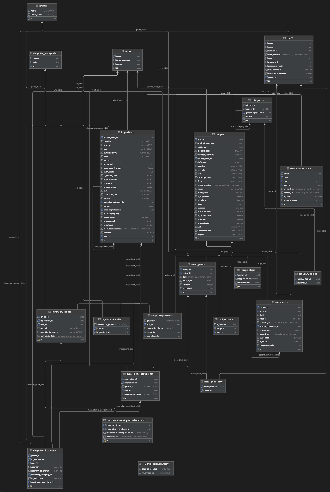

# Database Architecture, Data Processing & Media Storage

Pinula persists relational and localized domain state in PostgreSQL via Entity Framework Core (`PinulaDbContext`) and stores processed WebP media assets on local filesystem volumes managed by `IImageProcessingService`.

---

## 1. Relational Schema & Entity Clusters

`Pinula.API/Context/PinulaDbContext.cs` organizes 18 domain entities (`Pinula.API/Models/`) into five functional clusters:

1. **Users & Households:** `User`, `Group`, `VerificationCode` — manages authentication, granular user permissions, one-time verification codes, and shared household membership.
2. **Recipes & Taxonomy:** `Recipe`, `RecipeStep`, `RecipeIngredient`, `RecipeUser`, `Comment`, `Category` — stores user-authored recipes, preparation steps, ingredient quantities, favorites, nested comments/ratings, and hierarchical categories.
3. **Ingredients & Measurement Units:** `Ingredient`, `IngredientUnit`, `Unit`, `ShoppingCategory` — defines nutritional profiles, base units, unit-to-gram conversion factors, product-to-base-ingredient links, and store aisle groupings.
4. **Meal Planning:** `MealPlan`, `MealPlanIngredient` — schedules household meals by date and meal type, tracks participating group members, and stores recipe ingredient overrides.
5. **Pantry Inventory & Shopping List:** `InventoryItem`, `InventoryMealPlanAllocation`, `ShoppingListItem` — tracks household pantry stock with expiration dates, FEFO meal-plan gram reservations, and deficit-generated shopping list items.

### Schema & Data Lifecycle Decisions

* **Soft Deletion & Moderation Flags:** `Recipe` and `Ingredient` entities use `IsDeleted` flags (introduced in `20260613093108_AddIsDeletedToRecipes.cs`) rather than hard deletes so historical `MealPlan` and `Comment` foreign keys remain intact. Public catalog visibility is gated by `IsApproved` and `Checked` moderation flags (`20260708071127_IngredientModerationAdded.cs`).
* **Self-Referencing Hierarchies:** `Category.ParentCategoryId` models multi-level category trees, while `Ingredient.BaseIngredientId` maps specific barcode-scanned products to generic base ingredients so household pantry items can substitute for base recipe requirements.
* **UTC Timestamp Enforcement:** Date/time fields (`InventoryItem.ExpirationDate`, `User.UserCreated`, `VerificationCode.ExpiresAt`) normalize incoming values to `DateTimeKind.Utc` before persistence to prevent timezone drift across container environments.
* **Cascade & Referential Integrity:** Explicit relationship rules in `PinulaDbContext.OnModelCreating` (e.g., `20260827133719_FixMealPlanIngredientCascade.cs`) ensure deleting a `MealPlan` or `InventoryItem` cleans up dependent `MealPlanIngredient` and `InventoryMealPlanAllocation` rows without orphaned reservations.
* **PostgreSQL `snake_case` & Dynamic JSON Mapping:** `Program.cs` configures Npgsql with `EnableDynamicJson()` and `.UseSnakeCaseNamingConvention()` (`EFCore.NamingConventions`). This automatically translates C# `PascalCase` entity and property names into PostgreSQL `snake_case` table and column identifiers (e.g., `MealPlanIngredientId` -> `meal_plan_ingredient_id`) without manual `[Column]` attributes on every property.

---

## 2. Multi-Language Localization via PostgreSQL `jsonb`
Localized text fields (`Category.Names`, `Unit.Names`, `ShoppingCategory.Names`, `Ingredient.Names`, `Recipe.Titles`, `Recipe.Descriptions`, and `RecipeStep.Descriptions`) are modeled as `Dictionary<string, string>` properties mapped directly to PostgreSQL `jsonb` columns (`20260622123110_MigrateNamesToDictionary.cs`).

### Resolution & Query Execution
1. **Deterministic Fallback Chain:** Projection expressions (`CategoryProjections.cs`, `IngredientProjections.cs`) and Mapster rules (`MappingConfig.cs`) resolve strings using `requestedLang -> "en" -> default fallback` (e.g., `"Ingredient"`, `"Unit"`).
2. **SQL JSON Extraction:** Npgsql translates LINQ dictionary indexers (`i.Names[lang]`) into PostgreSQL JSON extraction operators (`->>`), evaluating locale fallbacks inside SQL `SELECT` projections without loading entire dictionaries when only a single preview string is needed.
3. **Cross-Provider Test Compatibility:** Because SQLite lacks a native `jsonb` column type, `PinulaDbContext.OnModelCreating` inspects `Database.ProviderName`. When running under SQLite (`TestDbContextFactory.cs`), EF Core automatically attaches a `ValueConverter<Dictionary<string, string>, string>` and maps dictionary properties to `TEXT` columns.

### Engineering Trade-Off
* **Advantage:** Eliminates normalized translation tables and repetitive multi-table `LEFT JOIN` chains on every read query while keeping multi-language inserts and updates atomic.
* **Limitation:** Queries cannot rely solely on standard relational indexes for multi-language text matching, requiring hybrid SQL/in-memory filtering for diacritic-insensitive search.

---

## 3. Unit Normalization, Query Sorting & Allocation Processing

### Base-Gram & Nutritional Normalization
Each `Ingredient` defines a default `Unit` (`DefaultUnitId`), per-100g nutritional macros (`Calories`, `Proteins`, `Fats`, `SaturatedFats`, `Carbohydrates`, `Sugars`, `Fiber`, `Salt`), an `EdibleRatio` (`20260625094143_EdibleRatioAddedToIngredientSystem.cs`), and unit-specific conversion rows (`IngredientUnit.AmountInGrams`). Recipe ingredients (`RecipeIngredient`), meal plan entries (`MealPlanIngredient`), pantry items (`InventoryItem`), and shopping list entries (`ShoppingListItem`) store both display `Quantity` and normalized `QuantityInGrams` so nutritional totals and inventory deductions execute on a uniform gram scale.

### Two-Stage Search & Diacritic-Insensitive Ranking
In `IngredientBackendService.cs` and `RecipeBackendService.cs`, full-text search handles Czech and English diacritics without requiring database-specific `unaccent` extensions:
1. **SQL Pre-Filtering (`ILike`):** EF Core filters candidate records on PostgreSQL using `EF.Functions.ILike` against `Names[lang]` and `Names["en"]` to minimize rows transferred over the network.
2. **In-Memory Tokenization & Relevance Sorting:** Because EF Core cannot translate custom C# string extensions into SQL expression trees, candidate entities are normalized in memory via `RemoveDiacritics().ToLowerInvariant()`, split into whitespace tokens, filtered so every search token matches at least one localized name, and ranked by prefix matches (`StartsWith(searchTokens[0])`) prior to applying `.Take(filter.Amount)`.

### FEFO Pantry Sorting & Deficit Allocation
`MealPlanBackendService` and `InventoryBackendService` synchronize household inventory (`InventoryItem`) with scheduled meals (`MealPlan`) using deterministic sorting and reservation rules:

| Stage | Processing & Sorting Rule                                                                                                                                            | Persistence Effect                                                                                                                                               |
| --- |----------------------------------------------------------------------------------------------------------------------------------------------------------------------|------------------------------------------------------------------------------------------------------------------------------------------------------------------|
| **1. Pantry Reservation** | Queries household `InventoryItem` rows matching `IngredientId` or `BaseIngredientId`, ordered ascending by `ExpirationDate` (**FEFO** — *First Expired, First Out*). | Creates `InventoryMealPlanAllocation` records reserving available free grams (`QuantityInGrams - AllocatedGrams`).                                               |
| **2. Deficit Calculation** | Subtracts total allocated grams from the required `MealPlanIngredient.QuantityInGrams`.                                                                              | Creates or increments a `ShoppingListItem` linked to `MealPlanIngredientId` for any unfulfilled gram deficit.                                                    |
| **3. Restock Reconciliation** | `ConvertShoppingItemsToPantryAsync` converts purchased shopping items into new `InventoryItem` records.                                                              | Automatically links new pantry stock back to open `MealPlanIngredient` deficits via `InventoryMealPlanAllocation` and removes fulfilled `ShoppingListItem` rows. |
| **4. Meal Consumption** | `MarkAsCookedAsync` finalizes a scheduled meal.                                                                                                                      | Deducts allocated gram quantities from `InventoryItem.QuantityInGrams` and deletes consumed `InventoryMealPlanAllocation` records.                               |

---

## 4. Server-Side Media Storage & Processing Pipeline

Uploaded images are stored on local disk under `Pinula.API/wwwroot/images/` (persisted via host volume mount `/home/pinula/images` in Docker) and organized into four domain folders: `recipes/`, `ingredients/`, `categories/`, and `avatars/`. All media operations are centralized in `Pinula.API/Services/ImageProcessingService.cs` (`IImageProcessingService`).

### Processing Pipeline

1. **Format & Binary Validation:** Rejects empty streams and extensions outside `[".jpg", ".jpeg", ".png", ".webp"]` with HTTP `400`, then decodes the input stream via `SKBitmap.Decode` to verify valid image headers.
2. **Aspect-Preserving Resize or Center Crop:**
* `ImageResizeType.Max`: Scales images proportionally down to fit target bounds without upscaling smaller images (e.g., `1200px` max width for recipes and ingredients, `800px` for categories).
* `ImageResizeType.Crop`: Scales the source bitmap to cover target dimensions and extracts a centered crop (e.g., `600x600` square user avatars).
3. **WebP Encoding & Resource Disposal:** Encodes bitmaps using `SKEncodedImageFormat.Webp` (default quality `80`, category icons quality `100`) and deterministically disposes unmanaged `SKBitmap`, `SKImage`, and `SKData` instances.
4. **Superseded File Cleanup:** When an entity image is updated or deleted, `DeleteImage` extracts the base filename via `Path.GetFileName` (preventing path traversal) and deletes the previous `.webp` file while protecting shared fallback assets (`ImageConstants.Default*` and any file prefixed with `default_`, such as `default_avatar.png` and `default_recipe_picture.png`).

### Engineering Trade-Off

* **Advantage:** Serving pre-scaled `.webp` files directly from local disk eliminates external object-storage latency and egress costs while keeping client payload sizes minimal.
* **Limitation:** Media storage is bound to a single container host filesystem, requiring persistent volume mounts across deployments.
---

## 5. Data Seeding & Offline Enrichment Tooling
* **Runtime Database Seeder (`Pinula.API/Services/NutriDbSeeder.cs`):** Populates foundational measurement units, shopping categories, and baseline nutritional records during initial environment setup.
* **Python Enrichment CLI (`tools/data-generator/`):** Standalone scripts (`enrich_ingredients.py`, `generate_images_ingredients.py`, `schemas.py`) batch-process ingredient metadata, generate multi-language translations and nutritional profiles, create ingredient imagery, and push updates to `Pinula.API` through administrative endpoints (`Pinula.API/Endpoints/ScriptEndpoint.cs`) using `DGIngredientUpdateDto`.
